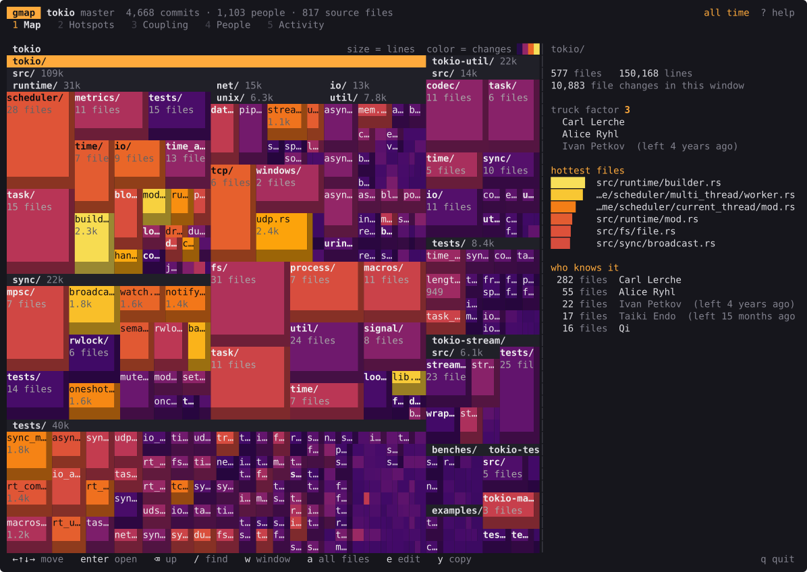
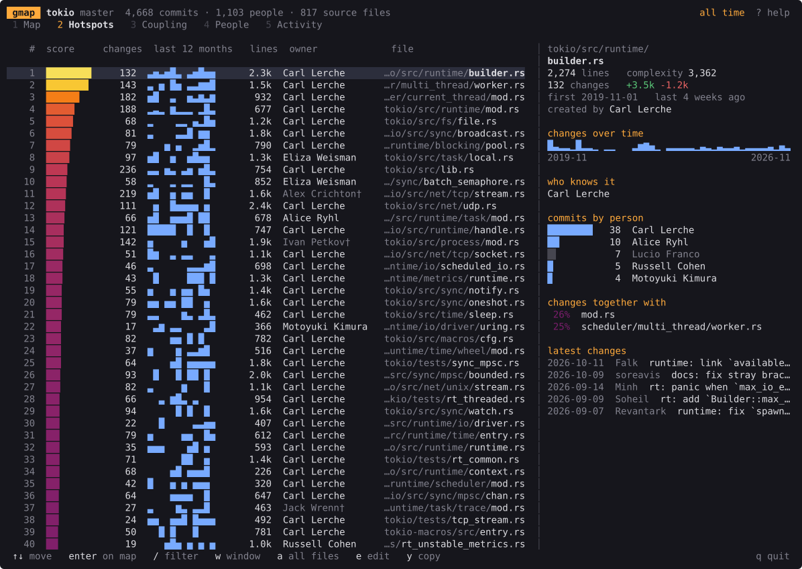

# gmap

Git history knows things the code doesn't say: which files keep breaking,
which files secretly depend on each other, and which code only one person
understands. gmap reads the history and shows you.

    cargo install gmap

    gmap                      the map
    gmap hotspots             files to worry about first
    gmap coupling --across    files that change together, in different folders
    gmap owners               who knows the code; the truck factor
    gmap activity             when commits happen

Every command takes `--since 6m`, `--author name`, a path to narrow to, and
`--json`.

## The map

Every source file is a rectangle. Area is lines of code. Color is how much it
changed lately: dark is quiet, yellow is where the work is. Folders open in
place, so you see the shape of the whole project at once. Arrows move, enter
goes into a folder, backspace comes out. The panel on the right says what the
selected file or folder is, who knows it and what it changes with. `?` lists
the keys.

## Hotspots

A file that is complicated and changes all the time is where bugs collect
(Tornhill, _Your Code as a Crime Scene_).

    score = Σ over changes of 2^(-age / half-life)  ×  ln(1 + complexity)

Complexity is indentation: leading whitespace in steps of four, summed over
lines. It needs no parser, works for any language, and tracks real complexity
metrics closely. The half-life is a year by default (`--half-life`), so a file
that was busy in 2017 and quiet since is not a hotspot now.

## Coupling

Two files that keep changing in the same commits depend on each other,
whether the code says so or not. Within a folder that's usually expected.
Across folders (`--across`) it's usually copy-paste: in tokio,
`net/tcp/split_owned.rs` and `net/unix/split_owned.rs` change together 70% of
the time.

Plenty of pairs overlap by chance, so each pair is tested. If two files
changed `a` and `b` times in `N` commits independently, their overlap follows
a hypergeometric distribution. A pair is shown only when its overlap would
happen by chance less than 1 time in 20 across all pairs tested (Bonferroni).
Commits touching more than 30 files and files created in the same commit
don't count.

## Owners

Who knows a file is estimated by degree of authorship (Fritz et al. 2014),
with the weights Avelino et al. fitted on 120 GitHub projects:

    DOA = 3.293 + 1.098·created + 0.164·your commits − 0.321·ln(1 + others' commits)

The truck factor is how many top owners can leave before more than half the
files have nobody left who knows them (Avelino et al. 2016). ripgrep's is 1,
tokio's is 6. gmap also lists files whose owners have all stopped committing.

## What it skips

- Anything that isn't source code. `--all` keeps docs, config and data.
- Lockfiles, `vendor/`, `node_modules/`, minified and generated files, and
  whatever `.gitattributes` marks `linguist-generated`, `linguist-vendored`,
  `-diff` or `binary`. `--exclude` adds more.
- Bots (dependabot, renovate, `[bot]`). `--bots` counts them.
- Merge commits, whose changes are already in the commits they merge.
- Commits in `.git-blame-ignore-revs`: mass reformatting says nothing.

Renames are followed, so a file keeps its history under its current name.
`.mailmap` is read, and one full name with several emails is one person.
Ages count back from the newest commit, not from today, so a finished project
still has a recent past.

## Speed

Every commit is diffed against its parent on all cores. Results are cached in
`.git/gmap/cache`, so the next run only reads new commits. Fastest of three
runs, Ryzen 5 5600G, Windows 11:

| repository | commits | gmap 0.5 | cached | `git log --numstat` |           gmap 0.4 |
| ---------- | ------: | -------: | -----: | ------------------: | -----------------: |
| ripgrep    |   2,303 |   0.44 s | 0.18 s |              0.85 s |              2.1 s |
| tokio      |   4,873 |   0.88 s | 0.21 s |               2.5 s |              5.2 s |
| git        |  82,725 |    7.3 s | 0.91 s |                34 s | crashed after 53 s |

Line counts match `git log --numstat --diff-algorithm=histogram`; there is a
test for it.

## Build

    cargo build --release
    cargo test

## License

MIT
